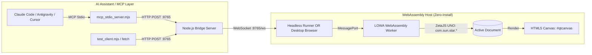

# ZetaOffice MCP

**LibreOffice WebAssembly + MCP.** Create, edit and export real Office documents from any MCP client — no desktop LibreOffice installation and no browser required.


Built on **ZetaOffice / LOWA** (LibreOffice compiled to WebAssembly), **ZetaJS** and the native **UNO API** (`com.sun.star.*`).

## Features

- **20 MCP tools**: document editing (`document`, `text`, `formula`, `picture`, `table`, `page`, `field`), structure and search (`structure`, `cursor`, `selection`, `search`), spreadsheets (`sheet`, `embed`), review (`track_changes`, `comments`), deterministic layout (`layout`), and utilities (`save`, `bridge`, `cookbook`, `uno`)
- **Native LibreOffice Math** (`formula`): real, editable Math objects (StarMath syntax), not text approximations
- **Pictures** (`picture`): embed png/jpg/gif/bmp files as real inline graphics
- **High-level capability layer**: Writer tables with totals, page setup/headers/footers, bookmarks/links/caption pairs, Calc sheets/validation/named ranges/number formats/freeze/date axes/cross-sheet charts — one call each
- **Headless by default**: the WASM engine runs inside Node (`server.mjs --node`); no browser or Chrome process
- **Real exports**: ODT, DOCX and PDF produced by LibreOffice's own filters
- **One active document**, driven over MCP stdio or plain HTTP/WebSocket

---

## 🏛️ Architecture



1. **Node.js Bridge (`server.mjs`)**: Listens on `http://localhost:8765` with Cross-Origin Isolation headers (`COOP`/`COEP`). It can run in **Headless Mode** (auto-spawning a silent background Wasm runner) or **Interactive Browser Mode**.
2. **MCP Stdio Server (`mcp_stdio_server.mjs`)**: Exposes 20 tools, including the consolidated editing tools, native Math (`formula`), inline graphics (`picture`), the high-level `table`, `page`, `field` and `sheet` operations, and the UNO-native `layout` layer. Features **Zero-Config Auto-Boot** (spins up the bridge automatically on launch).
3. **WebAssembly UI (`public/index.html`)**: Connects to the bridge via WebSocket and hosts the interactive ZetaOffice canvas.
4. **UNO Worker Thread (`public/office_thread.js`)**: Runs in the WebAssembly worker. It receives commands and manipulates the document using the real UNO API (`css.text.XTextDocument`, `text.insertString(...)`, `setPropertyValue(...)`).

---

## ⚙️ Selecting Execution Modes

You can choose between **Node.js Mode**, **Headless Chrome** and **Interactive Browser Mode**:

| Mode | Description | How to Select |
| :--- | :--- | :--- |
| **🟢 Node.js Mode** *(Default for MCP)* | Runs the Wasm runtime directly under Node (`worker_threads`) - no browser or Chrome process. Document processing, formatting and export work; live canvas rendering does not. | `node server.mjs --node`<br>`LOWA_NODE=1` |
| **🤖 Headless Chrome Mode** | Runs Wasm in a silent headless Chrome (full GUI build, renders offscreen). | `pnpm run start:headless`<br>`node server.mjs --headless`<br>`LOWA_NODE=0 HEADLESS=true` |
| **🖥️ Interactive Browser Mode** | Opens `#qtcanvas` in your desktop browser. You can watch the document render live in real-time as the AI writes and formats text. | `pnpm run start:browser`<br>`node server.mjs --browser`<br>`LOWA_NODE=0 HEADLESS=false` |

Node.js mode needs a one-time download + patch of the wasm bundle:

```bash
node lowa/prepare-cdn.mjs   # ~250 MB into lowa/cdn, see lowa/README.md
```

---

## 🧭 What the agent sees

The MCP surface is documented for agents, not just humans:

- **Server instructions** (sent on connect) summarise the workflow and the
  selection/formatting rules.
- **Tool descriptions** list each action, its parameters and the gotchas
  (paragraph-aware `insert`, stateful selection, 1-indexed paragraphs, 0-based
  offsets, unsupported features).
- **`libreoffice://guide` resource**: the full working notes (workflow,
  examples, limitations). Read it before multi-step editing.
- **Errors are actionable**: every rejected call returns
  `{success:false, action, error, suggestion}` instead of a bare message.

Recommended flow:

```
document(create) -> text(insert) -> structure(count|paragraph)
  -> selection(paragraph|range) -> text(format|style) -> save(export)
```

Formatting only applies to the **active selection**, so always call `selection`
immediately before `text(format)` and check the returned `{start, end, text}`.

Native math: `formula {action:"insert", formula:"e^{i %pi} + 1 = 0"}`
creates an editable LibreOffice Math object (StarMath syntax, not LaTeX), not a
text approximation. `list` / `update` / `delete` manage existing objects by
index; `align:"center"` and `display:true` place it on its own centered
paragraph. ODT keeps the object exactly; DOCX converts it to OMML, where
LibreOffice may lose complex layout such as n-ary limits.

### Presentations

`document {action:"create", doc_type:"presentation", slides:[...]}` builds a
native 16:9 Impress deck — one slide per entry, laid out with real drawing
shapes and exported as ODP, PPTX, PPT or PDF:

```json
{
  "action": "create",
  "doc_type": "presentation",
  "slides": [
    { "layout": "cover", "title": "Quarterly Review", "text": "Q3 results and next steps" },
    { "title": "Highlights", "text": "• Revenue up 18%\n• Two new markets", "notes": "Mention the hiring plan." },
    { "layout": "closing", "title": "Thank You", "text": "Questions?" }
  ]
}
```

`layout` is `cover` (default for the first slide), `content`, `section`,
`closing`, `stats` or `steps`. The builder uses a navy/gold corporate design
system: serif headlines, a gold-framed cover, oversized part numbers on section
dividers, and a consistent footer. `notes` adds speaker notes, `kicker`
overrides the small label above the title, `stats` renders up to four
`{value, label}` figures, and `steps` renders up to four `{title, text}` process
columns. `text` is plain text — `\n` starts a new paragraph, so use `• `
prefixes for bullets. There is no Markdown parsing.

---

## 🧭 Deterministic layout

`layout` adds stable paths, undo-group batches, measurement and geometric
diagnostics on top of UNO - without a second document model:

```json
{ "action": "begin" }
{ "action": "apply", "ops": [
  { "op": "set", "path": "doc/body/p[1]", "values": { "ParaStyleName": "Title" } },
  { "op": "set", "path": "doc/body/p[2]", "values": { "ParaTopMargin": 500 } }
] }
{ "action": "check", "paths": ["doc/body/p[1]", "doc/body/p[2]"] }
{ "action": "commit" }
```

See [docs/layout.md](docs/layout.md) for paths, measurement, diagnostics and the
determinism contract.

## 🚀 Quick Start

Requirements: **Node.js 20+** and network access on the first run. No Python, no browser and no LibreOffice installation are needed.

```bash
git clone https://github.com/erikmartino/zetaoffice-mcp.git
cd zetaoffice-mcp

# Start the MCP server (stdio).
# First run installs the Node dependencies and downloads the ~250 MB
# ZetaOffice WASM bundle, then the server is ready.
node start.mjs
```

That is the whole install: no build step and no manual dependency or bundle
setup. The same preparation runs automatically if you start the HTTP bridge
directly:

```bash
node server.mjs --node     # API at http://localhost:8765
```

For the interactive canvas, use `node server.mjs --browser` and open
`http://localhost:8765`. The legacy headless-Chrome mode is
`node server.mjs --headless`.

---

## 🤖 MCP Integration (Claude Code & Antigravity)

The server [`mcp_stdio_server.mjs`](mcp_stdio_server.mjs) provides **Zero-Config Auto-Boot**: if the bridge server isn't already running, `mcp_stdio_server.mjs` starts it automatically!

### 1. Claude Code CLI

Add the server directly from the command line:

```bash
# Headless Mode (default):
claude mcp add zetaoffice -- node $(pwd)/start.mjs

# Or Interactive Browser Mode:
claude mcp add zetaoffice -e HEADLESS=false -- node $(pwd)/start.mjs
```

### 2. Antigravity / Gemini CLI (`agy`)

Add via `/mcp` in chat or configure in `~/.gemini/config/mcp_config.json`:

```json
{
  "mcpServers": {
    "zetaoffice": {
      "command": "node",
      "args": ["/absolute/path/to/zetaoffice-mcp/start.mjs"],
      "env": {
        "HEADLESS": "true"
      }
    }
  }
}
```

### 3. Cursor & Claude Desktop

Add to `claude_desktop_config.json` or `cursor_settings.json`:

```json
{
  "mcpServers": {
    "zetaoffice": {
      "command": "node",
      "args": ["/absolute/path/to/zetaoffice-mcp/start.mjs"],
      "env": {
        "HEADLESS": "true"
      }
    }
  }
}
```

---

## 🎮 Controlling Modes from Chat (Claude or `agy`)

Even if started in headless mode, you can control the browser directly from your AI assistant conversation:

- **Open Browser Window**:
  Ask your assistant *"Open the document in browser"* or *"Show me the canvas"*.
  The assistant calls:
  ```json
  document(action="open_browser")
  ```
  This launches `http://localhost:8765` in your system's desktop browser. The
  call waits until the tab's Wasm worker is booted, and the bridge mirrors the
  current document from the headless runtime into that tab, so a document that
  was generated *before* the browser opened appears unchanged on the canvas.
  From then on every MCP call is routed to the visible tab (the headless runtime
  stays as a fallback when no browser is attached).

  A page that reconnects after a bridge restart re-announces itself as ready, so
  it keeps receiving edits instead of silently falling back to the headless
  runtime. Tabs running an out-of-date cached page are asked to reload once.

- **Check Current Mode & Health**:
  Ask your assistant *"Check LibreOffice status"*.
  The assistant calls:
  ```json
  document(action="status")
  ```
  Returns:
  ```json
  {
    "status": "healthy",
    "server": "ZetaJS Wasm MCP Bridge",
    "version": "1.0.0",
    "browser_connected": false,
    "runtime_connected": true,
    "node_runtime": true,
    "connected_clients": 1,
    "mode": "node",
    "headless_running": true,
    "url": "http://localhost:8765"
  }
  ```

  `mode` is `node`, `headless` or `browser`. `browser_connected` is true only
  when a browser tab is attached; the Node runtime is reported by
  `node_runtime` and keeps `runtime_connected` true on its own.

---

## 🧪 Testing the Bridge

Start the HTTP bridge (`node server.mjs --node`), then run the Node smoke test.
The MCP entry point itself is `node start.mjs`:

```bash
node test_client.mjs
```

It creates a document, inserts text and a native Math formula, lists the
formulas and exits non-zero on failure. Point it elsewhere with
`LIBREOFFICE_URL=http://host:port node test_client.mjs`.

---

## 🔍 How UNO Is Used Internally (`office_thread.js`)

Inside the WebAssembly worker thread, ZetaJS maps the C++ UNO IDL interfaces directly into JavaScript:

```javascript
import { ZetaHelperThread } from './zetajs/zetaHelper.js';

const zHT = new ZetaHelperThread();
const css = zHT.css; // uno.com.sun.star

// 1. Create a document via Desktop service
const xModel = zHT.desktop.loadComponentFromURL('private:factory/swriter', '_default', 0, []);

// 2. Query XTextDocument interface
const doc = css.text.XTextDocument.query(xModel);
const textObj = doc.getText();
const cursor = textObj.createTextCursor();

// 3. Insert text
textObj.insertString(cursor, "Hello via UNO!\n", false);

// 4. Set Character Properties via PropertySet
const props = css.beans.XPropertySet.query(cursor);
const boldAny = new Module.uno_Any(Module.uno_Type.Float(), 150.0);
props.setPropertyValue('CharWeight', boldAny);
boldAny.delete();
```

---
